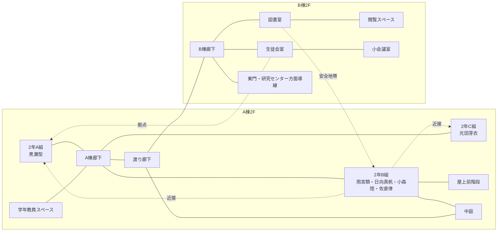

# 翠嶺高校2F詳細マップ

VS Code の Markdown Preview Mermaid Support で確認するためのMarkdown版です。  
元のMermaidソースは `04_MAPS/suirei_high_2f_detail.mmd` です。

## 読み方

- A棟2Fは、日常・教室・すれ違いの軸。
- B棟2Fは、図書室と生徒会室が並ぶ思想対比の軸。
- 2年B組から屋上前階段へ近く、雨宮と黒瀬の思想対話に使いやすい。
- 2年A組と2年B組は隣接し、黒瀬と雨宮が毎日すれ違える。
- B棟廊下の先に東門・研究センター方面導線があり、白庭計画側へ接続する。
